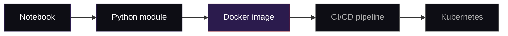

<div align="center">


[](https://github.com/arbaviskar02)
[](https://github.com/Infinity0077)
[](https://www.linkedin.com/in/anant-baviskar-b07b25236)
[](https://anant-portfolio-infinity.vercel.app)

</div>

---

## About

I trained as a data scientist (B.Tech CS, Data Science, RCPIT Shirpur) and built ML projects in NLP, regression and audio analysis.
Models are only useful when they run reliably, so I'm now going deep on the other half: **Linux, containers, CI/CD, Kubernetes and cloud**, through the C-DAC program.

```text
> status      : learning in public
> focus       : Linux + shell automation, then Docker
> goal        : take an ML project from notebook to production
> fuel        : phonk, chai, one more commit
```

---

## Cursed Techniques *(skills)*

Grouped by what I use them for. Honest about what's solid and what I'm still training.

**Solid**


**In training**


---

## Training Arc *(roadmap)*

| # | Arc | What I'm learning | Status |
|:-:|:--|:--|:--:|
| 1 | **Linux** | processes, permissions, cron, diagnostics | 🟣 now |
| 2 | **Networking** | TCP/IP, DNS, NGINX, TLS | ⚪ next |
| 3 | **Containers** | Dockerfiles, Compose, image hygiene | ⚪ next |
| 4 | **CI/CD** | Jenkins, GitHub Actions, quality gates | ⚪ |
| 5 | **Kubernetes** | pods, services, HPA, ingress | ⚪ |
| 6 | **Cloud + IaC** | Terraform, Ansible, AWS | ⚪ |

---

## Domain Expansion *(flagship goal)*

> **Resume Analyzer → production.**
> Take my NLP resume-matching tool from a notebook to a containerised API, behind a CI/CD pipeline, running on Kubernetes.



---

## Projects

| Project | What it does | Stack |
|:--|:--|:--|
| 📄 **Resume vs Job Match Analyzer** | Scores a resume against a job description and reports skill gaps | Python, spaCy, Pandas |
| 🌫️ **AQI vs Hospitalisation** | Relates city air quality to respiratory hospital admissions | Python, Seaborn |
| 📢 **Honk Heatmap** | Detects honking in traffic audio and maps noise hotspots | librosa, Folium |
| 🌐 **Portfolio** | My site, with project write-ups | Next.js, Contentful, Vercel |
| 🐧 **cdac-system-labs** | Shell monitors and permission audits | Bash |
| 🐳 **docker-blueprints** | Multi-stage Dockerfiles and Compose stacks | Docker, FastAPI |

<!-- Link each project to its repo: [name](https://github.com/...) -->

---

## Binding Vows *(how I work)*

Restrictions that make me stronger:

- **One lab, one commit, every day.**
- **I only claim what I can build and explain.**
- **If I automate it once, I never do it by hand again.**
- **Every project ships with a README a stranger can follow.**

---

<div align="center">


</div>

---

## Off the clock

🎬 Jujutsu Kaisen · Bleach · Black Clover · One Piece · Death Note
🎮 Roguelikes and tactical PC games
🎧 Phonk and chill instrumentals

---

## Contact

📧 [baviskaranant7@gmail.com](mailto:baviskaranant7@gmail.com) · 💼 [LinkedIn](https://www.linkedin.com/in/anant-baviskar-b07b25236) · 🌐 [Portfolio](https://anant-portfolio-infinity.vercel.app)

Open to internships, DevOps / cloud roles and study partners.


